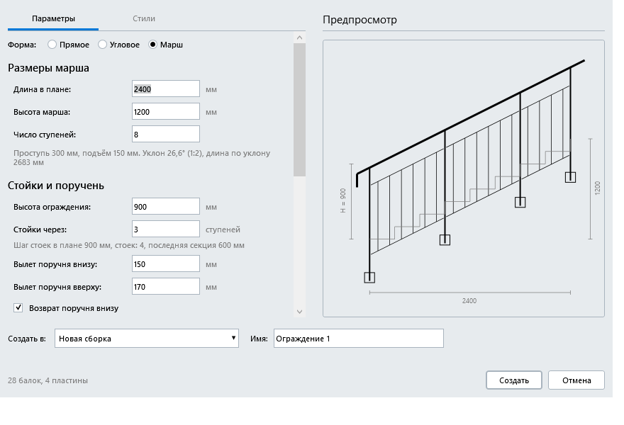

# Генератор ограждений для Renga

Плагин для [Renga](https://rengabim.com): создаёт ограждение из балок внутри сборки по заданной схеме — стойки, поручень, нижние перекладины, заполнение и пластины под стойками — для прямого и углового ограждений и для ограждения лестничного марша — и назначает им выбранные стили балок, стиль пластин и материал. Ограждение можно перестроить с другими параметрами: прежнее удаляется вместе с пластинами, остальные объекты сборки не затрагиваются.

Версия 0.3.

> Картинки в этом README - отрисовка окна плагина в тестовом приложении (с условными данными), а не снимки экрана из Renga: в самой Renga у окна есть заголовок и рамка, а списки стилей, материалов и сборок будут вашими.

## Возможности
- **Три формы ограждения**: прямое, угловое (Г-образное, угол 90°, два участка со своими длинами; угол можно сделать справа или слева) и марш (наклонное ограждение лестничного марша).
- **Марш**: вводятся длина марша в плане, высота марша и число ступеней (как в инструменте «Лестница»), проступь, подъём и уклон считаются и показываются. Стойки ставятся через заданное число ступеней, наклонный поручень с вылетами внизу и вверху, вертикальный возврат поручня (внизу и/или вверху), две наклонные перекладины с вертикальными торцами, вертикальные прутки между ними и боковые пластины под стойками.
- **Параметры**: длина (для углового - длины двух участков), высота (до верха поручня), вылет поручня за крайнюю стойку, разбивка на секции - по количеству секций или по наибольшему шагу стоек (шаг выравнивается по длине).
- **Состав**: сплошной верхний поручень, стойки, нижняя перекладина кусками между стойками (по желанию, с заданной высотой над полом).
- **Заполнение двух видов**: вертикальное (ряд прутков с заданным шагом, ряд центрируется в каждой секции) и горизонтальное (прутки вдоль ограждения между стойками: задаётся наибольший шаг по высоте, число прутков и точный шаг плагин считает сам и показывает).
- **Пластины под стойками** (по желанию): «Снизу, на плоскости» (горизонтальная пластина под стойкой) и «Сбоку, у косоура или торца» (вертикальная пластина у боковой грани, стойка примыкает к ней). Размер пластины берётся из выбранного стиля пластины, толщина и (для боковых) высота верха пластины задаются в окне.
- **Стили и материал**: стили балок для стойки, верхнего поручня, нижней перекладины и заполнения, стиль пластины - из стилей вашего проекта (стиль нижней перекладины у марша - тот же, что у заполнения); размеры сечений и пластин плагин читает из стилей сам. Один общий материал для всех балок и пластин (или «Без материала»).
- **Координаты**: ограждение строится в системе координат сборки от нуля в первой четверти (X и Y не отрицательные). Первый участок идёт вдоль +X, второй участок углового - из конца первого (угол справа) или из начала первого (угол слева) вдоль +Y; марш поднимается вдоль +X. Положение сборки в здании задаётся самой сборкой, как обычно в Renga.
- **Стыки**: на углу верхние поручни стыкует и подрезает сама Renga; концы нижних перекладин и горизонтальных прутков плагин ставит по граням стоек, верх вертикального заполнения - под верхним поручнем.
- **Куда создавать**: в существующую сборку или в новую (с именем, которое вы зададите в окне).
- **Перестроение**: если в сборке уже есть ограждение генератора, окно показывает его и подставляет прежние параметры; режим «Заменить» удаляет только объекты плагина (по метке, включая пластины), «Добавить» добавляет новое ограждение рядом. Ограждения, созданные версией 0.1, читаются как «Вертикальное» и «Без пластин».
- **Предпросмотр** схемы ограждения (фасад для прямого и марша, вид сверху для углового; пластины тонкими контурами) и счётчик «Будет создано: …» обновляются при каждом изменении параметров; при неверном вводе кнопка «Создать» недоступна, причина показана рядом с полем.
- **Окно**: две вкладки («Параметры» и «Стили»); строка «Создать в:» внизу: новая или существующая сборка. Enter создаёт, Esc закрывает.
- **Отмена**: два шага Ctrl+Z (три, если создавалась новая сборка). Итоговое окно подсказывает, сколько раз нажать.

## Что нового в 0.3
- Форма «Марш»: ограждение лестничного марша по длине, высоте и числу ступеней.
- Угловое ограждение: угол справа или слева.
- Окно переработано: две вкладки, пластины внутри «Параметров», строка «Создать в:» внизу, названия «нижняя перекладина» вместо «нижний поручень».
- Предпросмотр углового ограждения - вид сверху.
- Ограждения версий 0.1 и 0.2 открываются без изменений.

## Что нового в 0.2
- Горизонтальное заполнение как второй вид заполнения.
- Пластины под стойками: «Снизу» и «Сбоку», размер из стиля, толщина и верх пластины в окне, метка и «Заменить» работают и для пластин.
- Новая вкладка «Пластины», в «Стилях» - стиль пластины, материал теперь общий для балок и пластин.
- Ограждения версии 0.1 открываются без изменений.

## Требования
- Windows.
- Renga с поддержкой плагинов .NET 8 (в манифесте указан API 2.49).
- В проекте должен быть хотя бы один стиль балки (например, «Труба 30х30х3,5»); для пластин - хотя бы один стиль пластины.

## Установка
1. Скачайте архив `RailingGenerator-0.3.zip` на странице [Releases](../../releases).
2. Закройте Renga.
3. Распакуйте архив и скопируйте папку `RailingGenerator` в `C:\Program Files\Renga Professional\Plugins\` (потребуются права администратора). При обновлении с 0.1 или 0.2 замените папку `RailingGenerator` целиком.
4. Запустите Renga: на ленте появится кнопка «Генератор ограждений».

Если кнопки нет, посмотрите журнал `%localappdata%\Renga Software\Renga Professional\AecApp.log`. Журнал самого плагина - `%LOCALAPPDATA%\RailingGenerator\`.

## Как пользоваться
1. Откройте проект и нажмите «Генератор ограждений» на ленте.
2. Вкладка «Параметры»: выберите форму (прямое, угловое или марш), введите размеры (для марша - длину в плане, высоту и число ступеней), вылет и разбивку, включите нижнюю перекладину и заполнение. Ниже - секция «Пластины»: «Без пластин», «Снизу» или «Сбоку» (на марше - только «Сбоку»), толщина и верх пластины. Справа смотрите схему, внизу - счётчик.
3. Вкладка «Стили»: выберите стили балок, стиль пластины и общий материал.
4. Внизу в строке «Создать в:» выберите новую сборку (введите имя) или существующую. Если в существующей уже есть ограждение генератора, выберите «Заменить» или «Добавить».
5. Нажмите «Создать». Итоговое окно покажет числа и подскажет, сколько раз нажать Ctrl+Z для отмены.

## Известные ограничения
- Прямое, угловое (90°) и ограждение одного лестничного марша. Ограждения по ломаной с несколькими углами, по дуге, на площадках, а также марш вместе с площадкой в одной сборке не поддерживаются (площадки планируются отдельной версией). Марш строится в одну сторону (подъём вдоль +X); левый и правый варианты получаются зеркалированием экземпляра сборки в Renga.
- На марше пластины только «Сбоку»; нижней перекладины и горизонтального заполнения на марше нет. Положение профиля наклонных балок (поручень, перекладины) относительно линии определяет Renga; на разных проектах проверяйте стык поручня с возвратом глазами.
- Не создаются промежуточные поручни, решётка (вертикальные и горизонтальные прутки вместе), сплошное заполнение листом или стеклом и анкеры. Марка (`Mark`) объектов не заполняется - её задаёт проектировщик.
- Один общий материал на все объекты ограждения. Пластина «Сбоку» не уходит ниже нуля по Z.
- В угловом ограждении с пластинами «Сбоку» пластина угловой стойки может выступать за плоскость соседнего участка (порядка 30-40 мм, зависит от размера пластины).
- Новая сборка создаётся без экземпляра в здании: разместить её в модели нужно самостоятельно.
- Подрезку угла выполняет Renga: балка, созданная раньше (первый участок), продлевается до внешней грани, созданная позже (второй участок) обрезается. Нижние поручни, горизонтальные прутки и заполнение плагин рассчитывает сам; в местах, где Renga сама не подрезает, концы заданы по граням.
- Запись параметров балок и пластин (привязка профиля, толщина, материал) Renga принимает только отдельной операцией, поэтому отмена требует двух нажатий Ctrl+Z.
- Метка плагина - строковое свойство «Генератор ограждений: метка» на балках и пластинах; режим «Заменить» удаляет только объекты с этой меткой.
- Не проверено в самой Renga: окно при масштабе Windows 125 % и 200 % и при минимальном размере окна. Расчёт ограждения, проверка ввода и логика окна покрыты автоматическими тестами.

## О разработке
Плагин разработан с помощью искусственного интеллекта (Claude, Anthropic) под руководством автора. Работа плагина проверялась автором в Renga на тестовых проектах, но программа поставляется «как есть», без гарантий: перед использованием на важных проектах проверьте результат (ограждение отменяется Ctrl+Z).

## Лицензия
Все права защищены, см. [LICENSE](LICENSE). Исходный код не публикуется. Сторонние компоненты: Renga.WPF.Styles (MIT), сборки Renga SDK.
