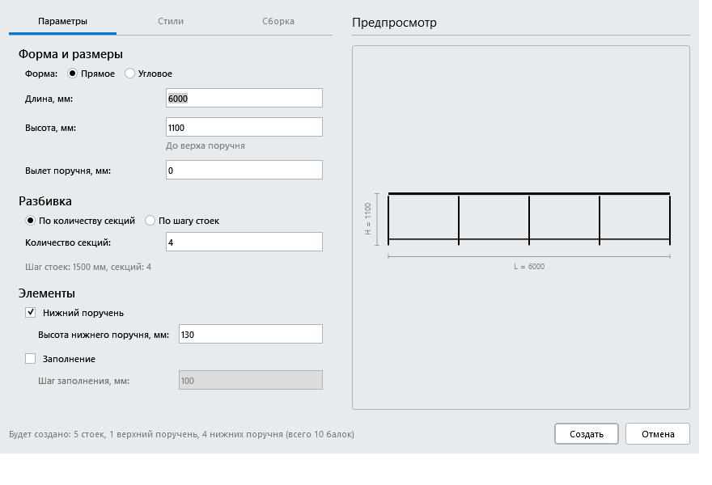
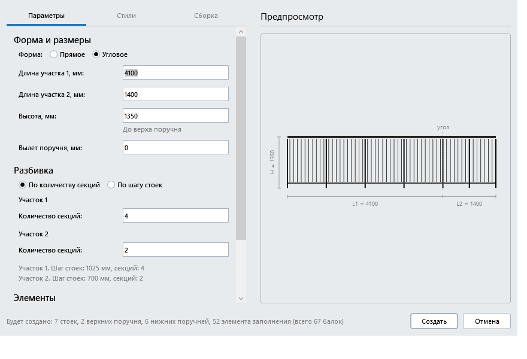
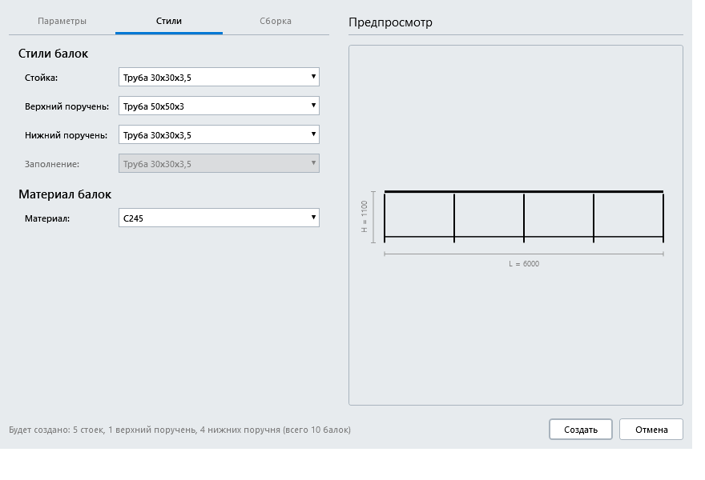
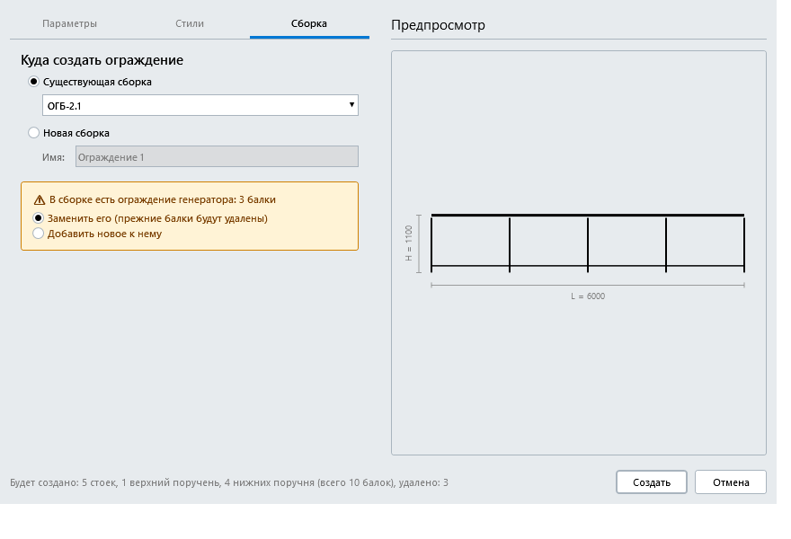

# Генератор ограждений для Renga

Плагин для [Renga](https://rengabim.com): создаёт ограждение из балок внутри сборки по заданной схеме — стойки, верхний поручень, нижние поручни и заполнение — и назначает им выбранные стили балок и материал. Ограждение можно перестроить с другими параметрами: прежнее удаляется, остальные балки сборки не затрагиваются.

Версия 0.1.

> Картинки в этом README - отрисовка окна плагина в тестовом приложении (с условными данными), а не снимки экрана из Renga: в самой Renga у окна есть заголовок и рамка, а списки стилей, материалов и сборок будут вашими.

## Возможности
- **Две формы ограждения**: прямое и угловое (Г-образное, угол 90°, два участка со своими длинами).
- **Параметры**: длина (для углового - длины двух участков), высота (до верха поручня), вылет поручня за крайнюю стойку, разбивка на секции - по количеству секций или по наибольшему шагу стоек (шаг выравнивается по длине).
- **Состав**: сплошной верхний поручень, стойки, нижний поручень кусками между стойками (по желанию, с заданной высотой над полом), заполнение вертикальными балками с заданным шагом (по желанию; ряд центрируется в каждой секции).
- **Стили и материал**: стили балок для стойки, верхнего поручня, нижнего поручня и заполнения выбираются из стилей вашего проекта; размеры сечений плагин читает из стилей сам. Один общий материал для всех балок (или «Без материала»).
- **Координаты**: ограждение строится в системе координат сборки от нуля в первой четверти (X и Y не отрицательные). Первый участок идёт вдоль +X, второй участок углового - из конца первого вдоль +Y. Положение сборки в здании задаётся самой сборкой, как обычно в Renga.
- **Стыки**: на углу верхние поручни стыкует и подрезает сама Renga; концы нижних поручней плагин ставит по граням стоек, верх заполнения - под верхним поручнем.
- **Куда создавать**: в существующую сборку или в новую (с именем, которое вы зададите в окне).
- **Перестроение**: если в сборке уже есть ограждение генератора, окно показывает его и подставляет прежние параметры; режим «Заменить» удаляет только балки плагина (по метке), «Добавить» добавляет новое ограждение рядом.
- **Предпросмотр** схемы ограждения (развёртка фасада) и счётчик «Будет создано: …» обновляются при каждом изменении параметров; при неверном вводе кнопка «Создать» недоступна, причина показана рядом с полем.
- **Отмена**: два шага Ctrl+Z (три, если создавалась новая сборка). Итоговое окно подсказывает, сколько раз нажать.

## Требования
- Windows.
- Renga с поддержкой плагинов .NET 8 (в манифесте указан API 2.49).
- В проекте должен быть хотя бы один стиль балки (например, «Труба 30х30х3,5»).

## Установка
1. Скачайте архив `RailingGenerator-0.1.zip` на странице [Releases](../../releases).
2. Закройте Renga.
3. Распакуйте архив и скопируйте папку `RailingGenerator` в `C:\Program Files\Renga Professional\Plugins\` (потребуются права администратора).
4. Запустите Renga: на ленте появится кнопка «Генератор ограждений».

Если кнопки нет, посмотрите журнал `%localappdata%\Renga Software\Renga Professional\AecApp.log`. Журнал самого плагина - `%LOCALAPPDATA%\RailingGenerator\`.

## Как пользоваться
1. Откройте проект и нажмите «Генератор ограждений» на ленте.
2. Вкладка «Параметры»: выберите форму (прямое или угловое), введите длину, высоту, вылет и разбивку, включите нижний поручень и заполнение при необходимости. Справа смотрите схему и счётчик балок.
3. Вкладка «Стили»: выберите стили балок для стойки, поручней и заполнения и общий материал.
4. Вкладка «Сборка»: выберите существующую сборку или создайте новую (введите имя). Если в сборке уже есть ограждение генератора, выберите «Заменить» или «Добавить».
5. Нажмите «Создать». Итоговое окно покажет числа и подскажет, сколько раз нажать Ctrl+Z для отмены.

## Известные ограничения
- Только прямое и угловое (90°) ограждение. Ограждения по ломаной с несколькими углами, по дуге и на лестничных маршах не поддерживаются.
- Не создаются промежуточные поручни и пластины под стойками (стойки начинаются с нулевой отметки). Марка балок (`Mark`) не заполняется - её задаёт проектировщик.
- Один общий материал на все балки ограждения.
- Новая сборка создаётся без экземпляра в здании: разместить её в модели нужно самостоятельно.
- Подрезку угла выполняет Renga: балка, созданная раньше (первый участок), продлевается до внешней грани, созданная позже (второй участок) обрезается. Нижние поручни и заполнение вдоль стоек плагин рассчитывает сам; в местах, где Renga сама не подрезает, концы заданы по граням.
- Запись параметров балок (привязка профиля, материал) Renga принимает только отдельной операцией, поэтому отмена требует двух нажатий Ctrl+Z.
- Метка плагина - строковое свойство «Генератор ограждений: метка» на балках; режим «Заменить» удаляет только балки с этой меткой.
- Не проверено в самой Renga: работа режима «Добавить», окно при масштабе Windows 125-200 % и при минимальном размере окна. Расчёт ограждения, проверка ввода и логика окна покрыты автоматическими тестами.

## О разработке
Плагин разработан с помощью искусственного интеллекта (Claude, Anthropic) под руководством автора. Работа плагина проверялась автором в Renga на тестовых проектах, но программа поставляется «как есть», без гарантий: перед использованием на важных проектах проверьте результат (ограждение отменяется Ctrl+Z).

## Лицензия
Все права защищены, см. [LICENSE](LICENSE). Исходный код не публикуется. Сторонние компоненты: Renga.WPF.Styles (MIT), сборки Renga SDK.
